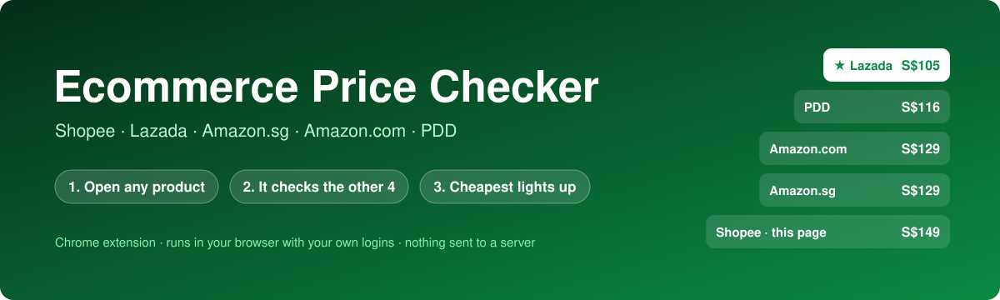
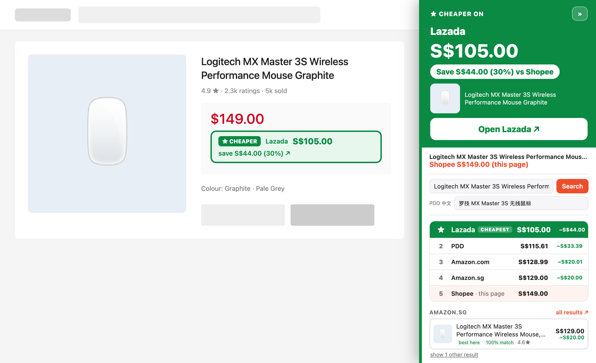
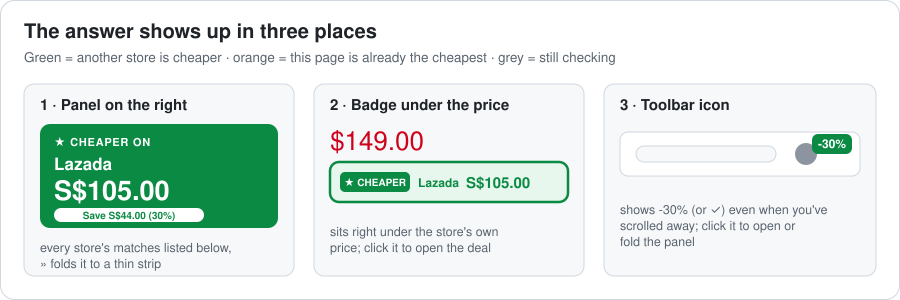
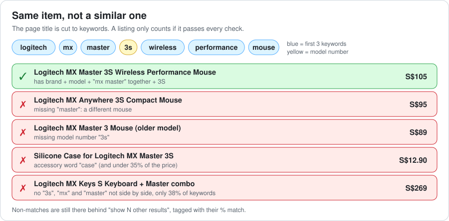
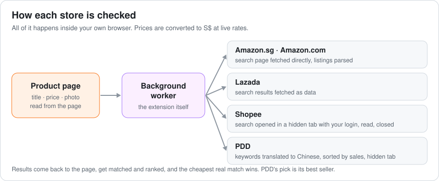

  

  

  <a href="#install">Install</a>
  &nbsp;·&nbsp; <a href="#how-to-use">How to use</a>
  &nbsp;·&nbsp; <a href="#how-it-finds-the-same-item">How it works</a>
  &nbsp;·&nbsp; <a href="#privacy">Privacy</a>
  &nbsp;·&nbsp; <a href="#how-its-built">How it's built</a>

---

**Ecommerce Price Checker** is a Chrome extension for shopping in Singapore. Open a product on
**Shopee, Lazada, Amazon.sg, Amazon.com or PDD**, and it quietly searches the other four stores
for the *same* item, then tells you where it's cheapest, in S$, before you pay.

 

<h1 align="center">⚙️ Under the hood</h1>

<i>Install · how to use · how it finds the same item · how it's built</i>

---

## Install

It isn't on the Chrome Web Store, so you load it yourself. It takes a minute and works in
Chrome, Edge, Brave and other Chromium browsers.

| | Step | What you do |
|:-:|---|---|
| **1** | **Download** | Click **Download the extension** above and unzip it. You get a folder called `ecommerce-price-checker-main`. |
| **2** | **Open extensions** | Go to `chrome://extensions` (`edge://extensions` in Edge) and switch on **Developer mode**, top right. |
| **3** | **Load it** | Click **Load unpacked** and pick the unzipped folder. Pin it from the 🧩 menu so you can see its `-30%` badge. |
| **4** | **Log in once** | Be logged in to **Shopee** (you probably are) and to **PDD's website** at `mobile.yangkeduo.com` (+65 SMS or scan the QR with the PDD app). Without a login those two stores are skipped and the panel tells you so. |

> **Updating:** download again, replace the folder, click ↻ on the extension card, then refresh any open store tabs.

## How to use

There's nothing to press. Open any product page on one of the five stores and the panel on the
right goes:

| Colour | Means |
|---|---|
| ⬜ **Grey** | Still checking. A progress bar fills as each store answers (usually 3–10 s). |
| 🟩 **Green** | **Another store is cheaper.** The panel shows the store, its price, how much you save, the listing, and a big **Open ↗** button. |
| 🟧 **Orange** | **This page is already the cheapest** of the stores that sell this item, with the runner-up underneath. |

Under the answer is a **price ladder** (every store's pick, cheapest on top) and each store's
matching listings, with a link to its full results.

- **Wrong keywords?** Edit them in the box and press **Search**. On PDD searches you can also fix
  the Chinese in the **PDD 中文** box.
- **Panel in the way?** Click **»** to fold it to a thin coloured strip down the right edge, with
  the answer written along it. Click the strip, or the toolbar icon, to bring it back. Windows
  narrower than 1000 px start folded.
- **Picked a different colour or size?** The price is re-read every couple of seconds and the
  comparison updates.

## How it finds the same item

The hard part of comparing prices isn't the searching. It's the hundreds of results that are
*almost* the item: the older model, the compact version, the case that fits it.

The page's title is cleaned of seller noise (`【Ready Stock】`, `🔥`, `SG local warranty`,
`free shipping`…) and cut to its first 8 keywords. A listing counts as the same item only if:

- it has the **first 3 keywords**, usually brand + product line, and keywords 2 and 3 appear
  **side by side**. So "MX Master" passes, but a title stuffed with "MX Anywhere … Master" doesn't;
- it has **every model number**, meaning any keyword with a digit (`3S`, `256GB`, `A15`);
- at least **60% of all the keywords** appear;
- it isn't an **accessory**: no `case`, `cover`, `compatible`, `protector`, `适用`, `手机壳`, `鼠标垫`…
  (unless you're shopping for a case), and not under **35% of this page's price**.

PDD titles are in Chinese, so they're compared in Chinese: the share of two-character pairs from
the translated keywords that appear in the title, with model numbers still required.

Among the matches, the **cheapest** wins at Amazon, Lazada and Shopee. At **PDD** the
**best-selling** match wins, because the cheapest PDD listing for a branded item is often not the
real thing.

## Where the prices come from

| Store | How it's searched | Price shown |
|---|---|---|
| **Amazon.sg** | Search page fetched and read | S$, item only |
| **Amazon.com** | Search page fetched and read | US$ → S$, before shipping to SG and GST |
| **Lazada** | Search results fetched as data | S$, item only |
| **Shopee** | Search opened in a hidden background tab using your login, read, then closed | S$, item only |
| **PDD** | Keywords translated to Chinese, searched in a hidden tab, ordered by sales | ¥ → S$, China price before forwarding to SG |

Exchange rates are live (open.er-api.com, refreshed every 12 h). Only one hidden tab is open
at a time, and it's muted and closed as soon as it's read.

**If a store asks "are you a robot?"** (Amazon captcha, Lazada slider, PDD verification), the
panel says so. Open that store once in a normal tab, solve it, then press **Search** again.

**PDD has no image search on its website** (only in its app), so PDD is always searched by
keywords.

## Privacy

- There's **no server**. Everything runs in your browser, and nothing is collected or stored
  anywhere except your own browser.
- The stores see an ordinary search from you, with your own cookies, as if you'd typed it.
- The only other things contacted are **open.er-api.com** (exchange rates, nothing about you)
  and **Google Translate**, which gets the product keywords for PDD searches and, on a PDD page,
  the Chinese title.
- It runs only on the five store sites. It can't see any other page you visit.

## How it's built

| Part | Language | Size |
|---|---|---|
| **Page reader**: finds the title, the price you actually see (respects the variant you picked) and the photo on each store | JavaScript | ~90 lines |
| **Matcher**: keyword cleaning, model-number and accessory rules, Chinese pair matching, sales parsing | JavaScript | ~80 lines |
| **Search and parsers**: Amazon HTML, Lazada data, Shopee / PDD results | JavaScript | ~130 lines |
| **Panel, badge and strip**: in a Shadow DOM so the store's styles can't break it, and it can't break theirs | JavaScript + CSS | ~340 lines |
| **Background worker**: cross-site fetches, hidden-tab reader, exchange rates, translation cache, toolbar badge | JavaScript | ~170 lines |
| **Manifest** | Chrome Manifest V3 | |

Plain JavaScript, **no framework, no libraries, no build step**: the folder you download is the
extension.

**Why a hidden tab for Shopee and PDD.** Both build their search results with JavaScript, behind a
login. A plain request gets an empty page or a login wall. So the extension opens the search in a
background tab, which uses your own logged-in session, reads the results from the page once
they've rendered, and closes the tab.

**Why a fetch for Amazon and Lazada.** Their search results arrive in the first response. A web page
on shopee.sg isn't allowed to read amazon.sg (browsers block that, it's called CORS). The
extension's background worker is allowed, for the five store sites only, so it fetches and hands
the page back to be parsed.

**Finding "the price".** Store pages are full of prices: list price, voucher price, bundle price,
"you may also like". The reader takes the **largest** price-shaped text on the page, which is the
one shoppers look at, and it follows the variant you select. On Amazon it reads the buy-box price.

---

Not affiliated with Shopee, Lazada, Amazon or Pinduoduo. Prices are a guide: check shipping,
vouchers and the exact variant before you buy.
